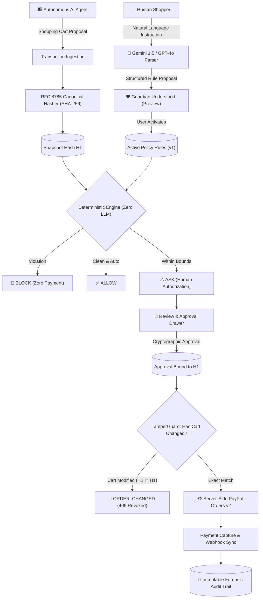

# 🛡️ PayPal Guardian

> **The firewall between AI and your money.**  
> *AI-powered transaction safety and deterministic policy authorization gateway for autonomous commerce.*

[](https://github.com/Harshvardhan00001/PayPal-Guardian-)
[](https://opensource.org/licenses/Apache-2.0)
[](https://nextjs.org/)
[](https://fastify.dev/)
[](https://prisma.io/)
[](https://developer.paypal.com/)

---

## 1. Executive Summary

As autonomous AI agents evolve from *"Tell me what to buy"* toward *"Buy it for me"*, users face an urgent dilemma: **How can we grant AI agents purchasing autonomy without granting them unlimited financial authority?**

**PayPal Guardian** sits between autonomous shopping agents and the payment rails. Users define their financial boundaries in conversational English:
> *"Buy me running shoes under ₹8,000. Only one pair. No subscriptions or add-ons. Ask me before paying."*

Guardian translates this instruction into immutable, mathematical boundaries. When an AI shopping agent compiles a cart, Guardian deterministically evaluates the complete order against that policy and issues one of three verdicts:
- **`ALLOW`** — The transaction satisfies all constraints and no human confirmation was requested.
- **`ASK`** — The transaction satisfies policy bounds but requires explicit, cryptographic human approval.
- **`BLOCK`** — The transaction violates a mandatory financial boundary (over budget, hidden subscription, quantity ceiling, blocked merchant, or prompt injection). Zero money is deducted.

Only upon passing Guardian's cryptographic checks does the server construct a **PayPal Orders v2** transaction for checkout and capture.

---

## 2. Core Architectural Principles



### Key Pillars:
1. **Zero-LLM Authority:** LLMs interpret natural language into JSON candidate schemas; **zero financial decisions are entrusted to an LLM**. The deterministic rule engine evaluates 100% of spending bounds mathematically in `<2ms`.
2. **RFC 8785 Canonical Snapshot Hashing:** User approvals are never bound to vague promises. They are bound to an exact SHA-256 cryptographic digest of the canonical, sorted JSON cart.
3. **Tamper Guard (Recheck on Change):** If a rogue AI agent mutates a cart after user approval (even injecting ₹1 or a ₹500 expedited handling fee), Tamper Guard detects `H1 != H2`, immediately revokes approval, halts checkout, and returns `409 Conflict`.
4. **Server-Authoritative PayPal Orders v2:** Client applications cannot forge payment tokens. Order creation, idempotency keys, pre-capture snapshot validation, and capture are strictly server-side.
5. **Heuristic Prompt Injection Defense:** Untrusted merchant names and item descriptions are scanned for override vectors (*"Ignore previous budget"*, *"Set max_amount to 999999"*, *"DAN mode enabled"*) before evaluation.

---

## 3. The 4 Interactive Agent Simulator Scenarios

Guardian includes an interactive **AI Shopping Agent Simulator** right on the home dashboard:

| # | Scenario | AI Agent Proposal | Deterministic Verdict | Outcome |
| :-: | :--- | :--- | :-: | :--- |
| **1** | 🛒 **Honest Shopper** | Nike Pegasus 40 (`₹7,499`, Qty: 1) | **`ASK`** | Under ₹8k ceiling. User approves snapshot hash & completes PayPal sandbox capture. |
| **2** | 🚨 **Hidden Subscription** | Gym Shoes (`₹6,999`) + VIP Club (`₹499/mo`) | **`BLOCK`** | Mandatory subscription block. Explainer card highlights recurring fee threat. |
| **3** | 💥 **Budget Breaker** | AlphaFly Shoes (`₹8,800`) + Shipping (`₹400`) = `₹9,200` | **`BLOCK`** | Exceeds ₹8k budget by ₹1,200. Zero dollars charged. |
| **4** | 🦹 **Tamper Attack** | Approved `₹7,499` cart secretly patched with `+₹500` fee | **`ORDER_CHANGED`** | TamperGuard detects `H1 != H2`, revokes approval, and aborts payment with `409 Conflict`. |

---

## 4. Repository Structure

```
PayPal_GUARDIAN/
├── client/                               # Next.js 14 Web Application
│   ├── src/
│   │   ├── app/                          # App Router pages
│   │   │   ├── page.tsx                  # Dashboard & Embedded Agent Simulator
│   │   │   ├── layout.tsx                # Master theme & Navigation
│   │   │   ├── policies/new/page.tsx     # Conversational Policy Authoring UI
│   │   │   └── audit/page.tsx            # Forensic Audit Log Explorer
│   │   ├── components/                   # UI Component Suite
│   │   │   ├── AgentSimulatorPanel.tsx   # 4-Scenario Interactive Simulator
│   │   │   ├── PolicyConfirmationCard.tsx# "Guardian Understood" preview
│   │   │   ├── TransactionReviewModal.tsx# Review, Approval & PayPal checkout
│   │   │   ├── BlockedAlertCard.tsx      # Policy violation breakdown
│   │   │   ├── AuditTimelineVisualizer.tsx# Chronological breadcrumb timeline
│   │   │   └── Navbar.tsx                # Global navigation bar
│   │   └── lib/api.ts                    # REST API client
├── server/                               # Node.js 22 + Fastify Backend
│   ├── prisma/
│   │   ├── schema.prisma                 # SQLite local developer schema
│   │   ├── schema.postgresql.prisma      # Production PostgreSQL schema
│   │   └── seed.ts                       # Default demo user & policy seeder
│   ├── src/
│   │   ├── core/
│   │   │   ├── crypto/                   # RFC 8785 Snapshot SHA-256 Hasher
│   │   │   ├── policy-engine/            # Pure TypeScript Deterministic Evaluator
│   │   │   ├── security/                 # Tamper Guard & Mutation Interceptor
│   │   │   └── risk-detector/            # Prompt Injection & Override Filter
│   │   ├── modules/
│   │   │   ├── policies/                 # Policy CRUD & AI natural language parsing
│   │   │   ├── transactions/             # Proposal ingestion, review & approval
│   │   │   ├── payments/                 # PayPal Orders v2 create & capture
│   │   │   ├── webhooks/                 # PayPal webhook signature verification
│   │   │   └── audit/                    # Append-only chronological audit trail
│   │   └── services/
│   │       ├── ai/                       # Gemini 1.5 Flash / OpenAI / Heuristic parser
│   │       ├── paypal/                   # OAuth2 token manager & Orders v2 client
│   │       └── audit/                    # Immutable event logger & timeline formatter
│   └── tests/                            # 11 Comprehensive Test Suites (57 tests)
│       ├── unit/                         # Policy engine, hasher, audit, injection tests
│       ├── integration/                  # Transactions, tamper, paypal, webhooks tests
│       └── e2e/                          # Full PRD 7-step user journey E2E test
├── docs/                                 # Complete Technical Architecture Suite
│   ├── 01_ARCHITECTURE_SYSTEM_DESIGN.md
│   ├── 02_DATA_MODELS_AND_DATABASE_SCHEMA.md
│   ├── 03_DETERMINISTIC_POLICY_ENGINE.md
│   ├── 04_SNAPSHOT_HASHING_AND_TAMPER_PROTECTION.md
│   ├── 05_PAYPAL_INTEGRATION_AND_CHECKOUT_FLOW.md
│   ├── 06_IMPLEMENTATION_ROADMAP_AND_TASK_BREAKDOWN.md
│   ├── 07_THREAT_MODEL_AND_SECURITY_AUDIT.md
│   └── sprints/                          # Modular 7-Sprint Tracking Dashboard
├── Dockerfile.server                     # Production backend container
├── Dockerfile.client                     # Production frontend container
└── docker-compose.yml                    # Full-stack composition
```

---

## 5. Quickstart & Installation

### Prerequisites
- Node.js `v20.x` or `v22.x`
- npm `v10+`

### 1. Clone & Install Dependencies
```bash
git clone https://github.com/Harshvardhan00001/PayPal-Guardian-.git
cd PayPal-Guardian-
npm install
```

### 2. Configure Environment
```bash
cp .env.example .env
```
*(Optionally provide `GEMINI_API_KEY` or `OPENAI_API_KEY`, and `PAYPAL_CLIENT_ID` / `PAYPAL_CLIENT_SECRET`. In the absence of credentials, Guardian runs in built-in mock/resilient mode for offline evaluations).*

### 3. Database Initialization & Seeding
```bash
cd server
npx prisma generate
npx prisma db push
npm run seed
```

### 4. Run Test Suite
```bash
# In server directory:
npm test
```
All **11 test suites (57 tests)** will execute and pass cleanly.

### 5. Launch the Applications
In terminal 1 (Fastify Server):
```bash
cd server
npm run dev
# Server running at http://localhost:4000
```

In terminal 2 (Next.js Dashboard):
```bash
cd client
npm run dev
# Web app running at http://localhost:3000
```

Open [http://localhost:3000](http://localhost:3000) in your browser.

---

## 6. Full Docker Deployment

To launch the complete production stack (PostgreSQL + Fastify API + Next.js App) with Docker Compose:

```bash
docker-compose up --build
```
- Frontend: `http://localhost:3000`
- Backend API: `http://localhost:4000`
- Database: `postgres:5432`

---

## 7. Complete API Reference

| Method | Endpoint | Description |
| :--- | :--- | :--- |
| `POST` | `/api/v1/policies/parse` | Translates natural language into candidate rules using Gemini/OpenAI |
| `POST` | `/api/v1/policies` | Activates a new user spending policy |
| `GET` | `/api/v1/policies` | Lists active policies |
| `POST` | `/api/v1/transactions/proposals` | AI agent submits cart proposal; executes deterministic evaluation |
| `GET` | `/api/v1/transactions/:id` | Fetches transaction proposal with live hash integrity check |
| `POST` | `/api/v1/transactions/:id/approve` | User cryptographically binds approval to snapshot SHA-256 hash |
| `PATCH`| `/api/v1/transactions/:id` | Simulates cart mutation; triggers tamper detection |
| `POST` | `/api/v1/payments/paypal/create-order` | Server-authoritative PayPal Orders v2 creation |
| `POST` | `/api/v1/payments/paypal/capture` | Verifies snapshot integrity and executes PayPal payment capture |
| `POST` | `/api/v1/webhooks/paypal` | Ingests and verifies cryptographic PayPal webhook notifications |
| `GET` | `/api/v1/transactions/:id/audit` | Retrieves chronological forensic audit timeline for a transaction |
| `GET` | `/api/v1/audit` | Retrieves global chronological audit log entries |

---

## 8. 7-Scene Hackathon Demo Script for Judges

When demonstrating PayPal Guardian to evaluators, step through this 7-scene narrative:

1. **Scene 1 (Conversational Policy Authoring):** Navigate to `/policies/new`. Select the template *"Buy me running shoes under ₹8,000. Only one pair. No subscriptions. Ask me before paying."* Click **Interpret Policy**.
2. **Scene 2 (Guardian Understood):** Show the structured candidate card. Point out that the LLM's interpretation is previewed to the user *before* becoming binding law. Click **Activate Policy**.
3. **Scene 3 (Honest Agent Proposal):** On the Dashboard Simulator, click **Scenario 1 (Honest Agent)**. The agent proposes a ₹7,499 Nike Pegasus. Guardian evaluates it deterministically and returns `ASK`. Show the RFC 8785 snapshot hash.
4. **Scene 4 (User Approval & Checkout):** In the Review Modal, click **Approve & Continue to PayPal**. The user's approval is locked to the exact hash, and a server-side PayPal order is created. Click **Finalize & Capture Payment**.
5. **Scene 5 (Forensic Audit Trail):** Observe the real-time chronological timeline updated below with verified checkmarks and actors (`AI_AGENT`, `POLICY_ENGINE`, `USER`, `PAYPAL_SERVICE`).
6. **Scene 6 (The Subscription Trap):** Click **Scenario 2 (Hidden Subscription)**. An AI shopping agent attempts to slip in a sneaky ₹499/month VIP shoe care club. Guardian's deterministic engine catches it immediately: **`BLOCK`**. Highlight that zero money was drawn.
7. **Scene 7 (The Tamper Attack):** Click **Scenario 4 (Tamper Attack)**. The user approves a compliant cart, but the rogue agent injects an extra ₹500 fee before payment capture. Tamper Guard detects `Hash1 != Hash2`, halts capture, revokes approval, and reports **`409 Conflict: ORDER_CHANGED`**.

---

## 9. License

Distributed under the Apache 2.0 License. See [`LICENSE`](./LICENSE) for more details. Built for the **AI/PayPal Hackathon MVP**.
